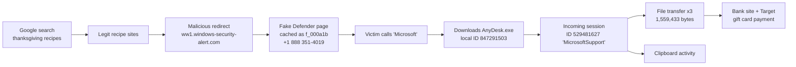

#sherlock #DFIR #windows-forensics #browser-forensics #chrome #anydesk #tech-support-scam
Difficulty: Very Easy
Author: akm626 · Official writeup dated 2026-02-05

Description: On 18 Feb 2025, Margaret was looking up Thanksgiving recipes when her browser went full-screen with a fake "your PC is infected" warning. She called the number on screen and reached a man claiming to be from "Microsoft Support". He had her download a remote-access program, spent over an hour "cleaning" her PC, then charged her $500, paid in gift cards. We get a disk image of her machine and have to rebuild what happened from **Chrome** and **AnyDesk** artifacts.

- Personal Summary:
    - New terms, things to learn: tech support scam (TSS), Chrome `History` SQLite DB, Chrome disk cache (`Cache_Data`, `f_` files), WebKit/Chrome timestamps, AnyDesk artifacts (`system.conf`, `ad.trace`, `connection_trace.txt`), mounting a raw FAT image read-only
    - Goals: Identify the victim's and the attacker's AnyDesk IDs, find the malicious redirect and the scam page, recover the scam phone number, and measure what was stolen (files, bytes, session length).

> [!summary] TL;DR: the whole story in one line
> Google search → recipe sites → **malicious redirect `ww1.windows-security-alert.com`** → fake Windows Defender page showing **+1 (888) 351-4019** → victim calls → downloads **AnyDesk.exe** → scammer (**ID 529481627, alias "MicrosoftSupport"**) connects → **3 files exfiltrated (1,559,433 bytes)** over a **4052 s (~67 min)** session → victim visits her bank and Target to buy gift cards.

---

## 1. Background: how a tech support scam works

Read this first. Once you know the playbook, every question in this Sherlock becomes "find the evidence for step X".

> [!info] The tech support scam (TSS) playbook
> 1. **Lure**: the victim lands on a malicious page, usually through malvertising or a hijacked or typo-squatted domain, while browsing for something harmless (here, recipes).
> 2. **Scare**: the page goes full-screen, mimics Windows Defender or Microsoft, sometimes plays alarms, and makes the browser hard to close ("browser locker").
> 3. **Call**: the only "fix" offered is a toll-free number. The scammer, not malware, does the rest.
> 4. **Access**: the victim is talked into installing a **legitimate** remote-access tool (AnyDesk, TeamViewer, UltraViewer, QuickAssist...). Because the tool is legitimate, antivirus doesn't flag it.
> 5. **Theatre**: the scammer opens Event Viewer, `cmd`, `netstat` and similar, and presents normal output as "proof of hackers".
> 6. **Theft + payment**: data is quietly exfiltrated over the tool's file-transfer feature, then payment is demanded in an untraceable form (gift cards, crypto, wire).

The Sherlock maps to that chain like this:



| Story step | Artifact that proves it | Question |
|---|---|---|
| Normal browsing | Chrome `History` → `urls` table | Q2, Q10 |
| Redirect to scam | Chrome `History` (URL sequence) | Q3 |
| Scam page content | Chrome cache `Cache_Data/f_000a1b` | Q4 |
| AnyDesk installed/run | `Downloads/AnyDesk.exe`, `system.conf` | Q1 |
| Remote connection | `ad.trace` (+ `connection_trace.txt`) | Q5, Q6 |
| Session length | `ad.trace` session summary | Q7 |
| Data theft | `ad.trace` file-transfer lines | Q8, Q9 |

---

## 2. Learning

### 2.1 The evidence: a raw FAT disk image
- The ZIP (`RemoteAccessRegret.zip`, password `hacktheblue`) contains **`intelvol.raw`**, a raw (`dd`-style) image of a small volume.
- `file intelvol.raw` reports `DOS/MBR boot sector ... OEM-ID "mkfs.fat" ... FAT (16 bit)`, label `INTELVOL`. So it's a plain FAT16 filesystem, and Linux can mount it directly.
- **Always mount evidence read-only** (`-o ro`). `loop` lets Linux treat a file as a block device.

### 2.2 Chrome artifacts
Chrome profile path on Windows: `C:\Users\<user>\AppData\Local\Google\Chrome\User Data\Default\` (in this image it's `User_Data`).

| File | What it is | Why we care |
|---|---|---|
| `History` | SQLite DB | URLs visited, visit times, downloads |
| `Cache/Cache_Data/` | Disk cache | Copies of pages and resources as the victim saw them |
| `Cookies`, `Login Data`, `Web Data` | SQLite DBs | Sessions, saved logins, autofill (not provided here) |

**Important tables inside `History`:**
- `urls`: one row **per unique URL**: `id, url, title, visit_count, typed_count, last_visit_time, hidden`.
- `visits`: one row **per visit**: `url` (→ `urls.id`), `visit_time`, `from_visit` (the previous page), `transition` (typed, link, redirect...). This is the table that shows *how* the user got from page A to page B.
- `downloads` + `downloads_url_chains`: what was downloaded, from where, and where it was saved. This is where you'd confirm the `AnyDesk.exe` download.

> [!warning] Chrome timestamps are not Unix time
> Chrome stores **WebKit time**: microseconds since **1601-01-01 00:00:00 UTC**. To convert in SQLite:
> ```sql
> datetime(last_visit_time/1000000 - 11644473600, 'unixepoch')
> ```
> `11644473600` is the number of seconds between 1601-01-01 and 1970-01-01.

**Chrome cache in a nutshell:**
- `index` = the cache's lookup table. Small entries are packed into `data_0..data_3` block files. Larger entries get their own **external file named `f_XXXXXX`** (hex counter), e.g. `f_000a1b`.
- An `f_` file is usually the **raw response body**: HTML, JS, an image... Run `file` on it first, because it may be gzip/brotli-compressed. Here it's plain HTML, so `cat` works.
- Why it matters: even if the scam domain is gone, the cache keeps **exactly what the victim saw**, including the phone number.

### 2.3 AnyDesk artifacts
AnyDesk is a legitimate remote-desktop tool, and scammers love it because it can run **portable** (no install, no admin).

| Location | Mode | Files |
|---|---|---|
| `%APPDATA%\AnyDesk\` (`Users\<u>\AppData\Roaming\AnyDesk`) | Portable / per-user | `system.conf`, `user.conf`, `ad.trace`, `connection_trace.txt` |
| `%PROGRAMDATA%\AnyDesk\` | Installed as service | `service.conf`, `system.conf`, `ad_svc.trace`, `connection_trace.txt` |

- `system.conf`: config. In this lab the ID is `id=` under `[client]`. Real AnyDesk installs usually write it as `ad.anynet.id=`, so grep for `id=` to catch both. **This is the victim machine's own AnyDesk ID.**
- `ad.trace`: the main, very verbose log. It records start-up, the assigned ID, incoming requests with **Remote ID + Alias**, accepted permissions, **file transfers with full paths and byte counts**, clipboard activity, and a session summary.
- `connection_trace.txt`: one short line per connection: direction (Incoming/Outgoing), date/time, how it was accepted (User / Passwd / Token), remote ID. A quick cross-check for `ad.trace`.

> [!tip] Reading the location
> The logs are in **Roaming** and `AnyDesk.exe` sits in **Downloads**, so Margaret ran it as a **portable** download and never installed it. That's typical of a scam: "Go to anydesk.com, click download, open it, read me the 9-digit number."

### 2.4 Other artifacts in the image (not needed for the questions, worth knowing)
- `Windows/Prefetch/`: evidence of program execution (e.g. `ANYDESK.EXE-xxxx.pf` with run count and last-run times). Empty in this tree.
- `Windows/System32/winevt/Logs/Security_4688.xml`: an export of **Event ID 4688 (process creation)**. It can show `AnyDesk.exe` being launched, its parent process, and when. It's a good second source to corroborate the AnyDesk timeline if you want to go beyond the questions.

---

## 3. Key tools + commands

- **Identify + mount the image**
    - `file intelvol.raw` → identify the filesystem.
    - `sudo mkdir -p /mnt/intelvol`
    - `sudo mount -o loop,ro -t vfat intelvol.raw /mnt/intelvol/` (`loop` = file as disk, `ro` = read-only, `vfat` = FAT driver)
    - `tree -la /mnt/intelvol` → map what's in the image before touching anything.
- **SQLite / DB Browser for SQLite** (`sqlitebrowser`): GUI for the Chrome `History` DB. The CLI `sqlite3` works too (see queries below).
    - Work on a **copy** of `History`, because opening it can create journal files.
- **cat / grep / strings** for text logs and cache files.
- **Browser**: open the cached HTML locally to *see* what the victim saw (safe here because it's a static HTML file; in a real case use an isolated VM).
- Windows alternatives: **Hindsight** (Chrome history/cache parser), **ChromeCacheView** (NirSoft), **Autopsy** (loads the whole image and has Web History + cache modules).

Useful one-liners:
```bash
# Chrome history, human-readable times, oldest first
sqlite3 History "SELECT id, url, title, visit_count,
  datetime(last_visit_time/1000000-11644473600,'unixepoch') AS last_visit
  FROM urls ORDER BY last_visit_time ASC;"

# Every visit with how the user got there (shows redirects)
sqlite3 History "SELECT v.id, datetime(v.visit_time/1000000-11644473600,'unixepoch'),
  u.url, v.from_visit, v.transition & 0xFF AS core_transition
  FROM visits v JOIN urls u ON v.url = u.id ORDER BY v.visit_time;"

# Downloads (where did AnyDesk.exe come from?)
sqlite3 History "SELECT target_path, tab_url, referrer,
  datetime(start_time/1000000-11644473600,'unixepoch') FROM downloads;"

# Pull a phone number out of the cached page
grep -oE '\+?1? ?\(?[0-9]{3}\)?[ -]?[0-9]{3}-[0-9]{4}' Cache/Cache_Data/f_000a1b

# AnyDesk: the interesting lines only
grep -E 'Remote ID|Alias|Session|Permissions|File transfer|Clipboard|Total' ad.trace
```

---

## 4. Doing the sherlock

Paths below are relative to `/mnt/intelvol/Users/Margaret/AppData/`.

Question 1: What is the local AnyDesk ID assigned to the victim's computer?
- Where: `Roaming/AnyDesk/system.conf`
- `cat system.conf` → under `[client]`: `id=847291503`
- Cross-check: `ad.trace` also logs `Assigned ID: 847291503` at start-up.
- Side notes from the same file: `session_recording=0` (no recording, so no video evidence), `direct_auto_accept=0` (someone had to click **Accept**, so the victim let the scammer in herself), empty `unlock_password_hash` and `access_control_list` (no unattended access configured).
- Answer: `847291503`

> [!note] Why the *local* ID matters
> The victim reads this number to the scammer over the phone, and that's how he connects. In a real investigation this ID can also be given to AnyDesk in an abuse report.

Question 2: Using the Chrome History database, what was the first website Margaret visited before encountering the scam?
- Where: `Local/Google/Chrome/User_Data/Default/History` → table `urls` → sort by `last_visit_time` ascending.
- First entry: a Google search for Thanksgiving recipes.
- Answer: `www.google.com`

Question 3: What is the domain of the initial malicious redirect that led Margaret to the scam page?
- Same `urls` table: after the legitimate recipe sites, the first URL that doesn't belong is the redirect.
- Answer: `ww1.windows-security-alert.com`

> [!tip] How to spot it
> - It uses brand words (**windows**, **security**, **alert**) on a domain Microsoft doesn't own. Real Microsoft pages live on `microsoft.com` / `windows.com`.
> - `ww1.` subdomains are common on parked or malvertising domains.
> - It arrives right after an innocent site, with no search or typing in between, so it's a redirect and not something she chose. In the `visits` table, the `transition` / `from_visit` columns would show this.

Question 4: The scam page was cached by Chrome. Examining the cached HTML file, what phone number was displayed to the victim?
- Where: `Local/Google/Chrome/User_Data/Default/Cache/Cache_Data/f_000a1b`
- `cat` it → a full HTML page with title "Microsoft Windows Defender Alert", fake "Threat Detected: Trojan...", "Status: CRITICAL", "Risk Level: SEVERE", "Your computer has been LOCKED...", "DO NOT turn off your computer", then a big **"Call Microsoft Support Now"** box.
- Opening it in a browser renders the fake Windows Defender warning with a blue background.
- Answer: `+1 (888) 351-4019`

Question 5: What is the AnyDesk ID of the remote machine that connected to Margaret's computer?
- Where: `Roaming/AnyDesk/ad.trace`
- `info 2025/02/18 08:41:17.332 anydesk - Incoming session request`
- `info 2025/02/18 08:41:17.334 anydesk - Remote ID: 529481627`
- Answer: `529481627`

Question 6: What alias did the scammer use for their AnyDesk connection?
- Next line in `ad.trace`: `08:41:17.445 anydesk - Alias: MicrosoftSupport`
- An alias is a display name the user picks, so anyone can call themselves "MicrosoftSupport". It's chosen to make the victim's accept prompt look official.
- Answer: `MicrosoftSupport`

Question 7: According to the AnyDesk logs, what was the total session duration in seconds?
- End of `ad.trace` → session summary → `Session duration: ...`
- Answer: `4052` (= 67 min 32 s, which matches "over an hour" in the scenario)

Question 8: The AnyDesk logs show files were exfiltrated. What is the filename (not full path) of the first file stolen from Margaret's Desktop?
- `grep "File transfer" ad.trace` → three uploads (local → remote = exfiltration):
    1. `C:\Users\Margaret\Desktop\Bank Statements 2024.pdf` (247,293 bytes)
    2. `C:\Users\Margaret\Documents\Tax Return 2023.pdf` (1,293,847 bytes)
    3. `C:\Users\Margaret\Desktop\Passwords.docx` (18,293 bytes)
- Answer: `Bank Statements 2024.pdf`

Question 9: How many bytes total were uploaded (exfiltrated) to the remote attacker during the session?
- Session summary → `Total transferred:` upload byte count.
- Sanity check: 247,293 + 1,293,847 + 18,293 = **1,559,433**, which matches the summary.
- Answer: `1559433`

Question 10: Based on the Chrome History, how many total URLs were visited during the browsing session on the day of the incident?
- `SELECT COUNT(*) FROM urls;`
- After AnyDesk, the list also shows her **banking site** and **Target**, the "pay with gift cards" step.
- Answer: `10`

> [!warning] `urls` ≠ `visits`
> `COUNT(*) FROM urls` counts **unique URLs**. If a page was visited twice, it's still one row (with `visit_count = 2`). To count every page load, use `SELECT COUNT(*) FROM visits;`. Read the question carefully to know which one it wants.

---

## 5. Reconstructed timeline (18 Feb 2025)

AnyDesk times are as written in `ad.trace`. Browser rows are in order but without exact times (convert `last_visit_time` with the query above to fill them in).

| Time | Source | Event |
|---|---|---|
| — | History | Google search "thanksgiving recipes" → recipe sites |
| — | History | Redirect to `ww1.windows-security-alert.com` |
| — | Cache `f_000a1b` | Fake Defender page with **+1 (888) 351-4019** shown |
| — | Filesystem | `AnyDesk.exe` saved in `Downloads` |
| 08:35:11 | ad.trace | AnyDesk starting (v8.0.8, win32, free licence) |
| 08:35:12 | ad.trace | Assigned ID `847291503`; relay connected; ready |
| 08:41:17 | ad.trace | **Incoming session request**, Remote ID `529481627`, Alias `MicrosoftSupport` |
| 08:41:23 | ad.trace | Request **accepted by local user** → session established |
| 08:41:23 | ad.trace | Permissions granted: **input, clipboard, filetransfer** |
| 08:42:15 | ad.trace | Remote keyboard input active (scammer is "driving") |
| 08:48:22 | ad.trace | **File manager opened by remote** |
| 08:52:17 | ad.trace | Upload `Desktop\Bank Statements 2024.pdf` (247,293 B) |
| 08:55:08 | ad.trace | Upload `Documents\Tax Return 2023.pdf` (1,293,847 B) |
| 09:01:33 | ad.trace | Upload `Desktop\Passwords.docx` (18,293 B) |
| 09:22 → 09:34 | ad.trace | 3× "Clipboard: text copied to remote (19 chars)" |
| ≈ 09:48:55 | computed | Session ends (08:41:23 + 4052 s) |
| after | History | Banking site, then Target (gift cards) |

> [!question] Open thread worth thinking about
> Three clipboard copies of the same length (19 chars) went *to* the remote side late in the session, around the time payment was being arranged. The writeup doesn't explain them. A good analyst would flag this and ask the victim what she copied. Card numbers, codes or passwords are all plausible, but the log only shows the length, not the content.

---

## 6. Takeaways / IOCs

**IOCs**
| Type | Value |
|---|---|
| Domain | `ww1.windows-security-alert.com` |
| Phone (scam line) | `+1 (888) 351-4019` |
| AnyDesk ID (attacker) | `529481627` |
| AnyDesk alias | `MicrosoftSupport` |
| AnyDesk ID (victim) | `847291503` |
| Exfiltrated files | `Bank Statements 2024.pdf`, `Tax Return 2023.pdf`, `Passwords.docx` |
| Data volume | 1,559,433 bytes |

**Workflow to remember for "remote access scam" cases:**
**mount RO → `tree` → Chrome `History` (urls + visits + downloads) → cache `f_` files for the lure page → AnyDesk `system.conf` (victim ID) → `ad.trace` (remote ID, alias, permissions, file transfers, clipboard, summary) → `connection_trace.txt` + 4688 / Prefetch to corroborate.**

**Lessons**
- Legitimate tools leave great logs. AnyDesk's `ad.trace` basically writes the incident report for you: who, when, what permissions, which files, how many bytes.
- The browser cache is a time machine. It shows what the victim actually saw, even after the scam domain is taken down.
- Two sources beat one. The victim ID appears in `system.conf` and `ad.trace`, and the byte total can be checked by adding up the per-file transfers. Cross-checking like this is a good habit.
- What this means for the victim: the bank statements, tax return (identity-theft material) and a passwords file are all gone. Response steps: contact the bank, reset **every** password in `Passwords.docx` (enable MFA), place a credit freeze/fraud alert, report to the FTC/IC3 and to AnyDesk (abuse report with ID `529481627`), and report the gift cards to Target quickly in case the funds can still be frozen.
- Prevention: block or alert on remote-access tools that aren't part of IT's toolset (AnyDesk/TeamViewer/etc. via AppLocker/WDAC or EDR), use DNS filtering for newly registered/typosquat domains, and teach the rule **Microsoft never cold-calls and never asks for gift cards**.
